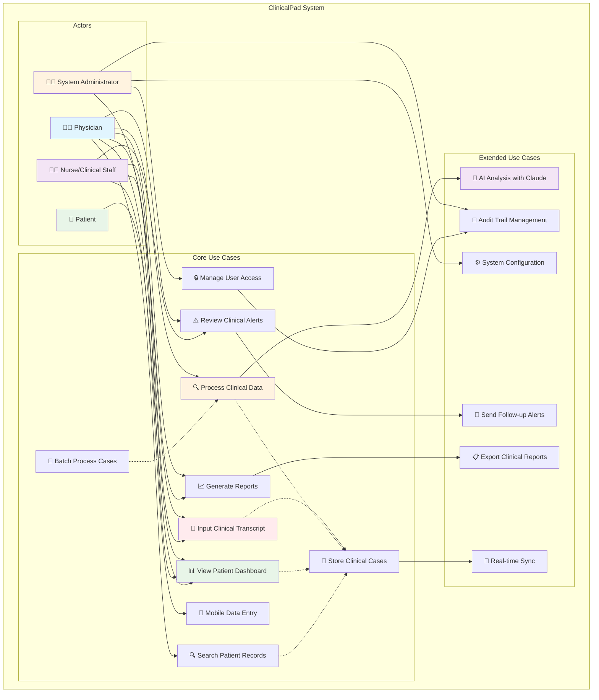
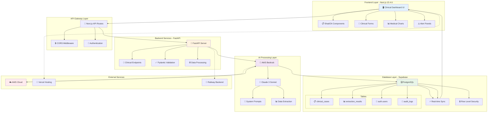
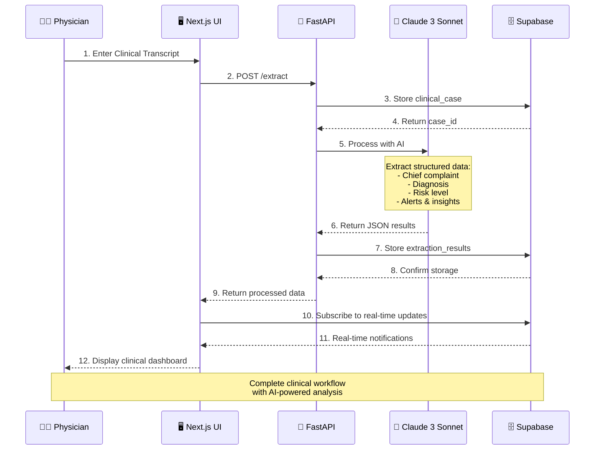
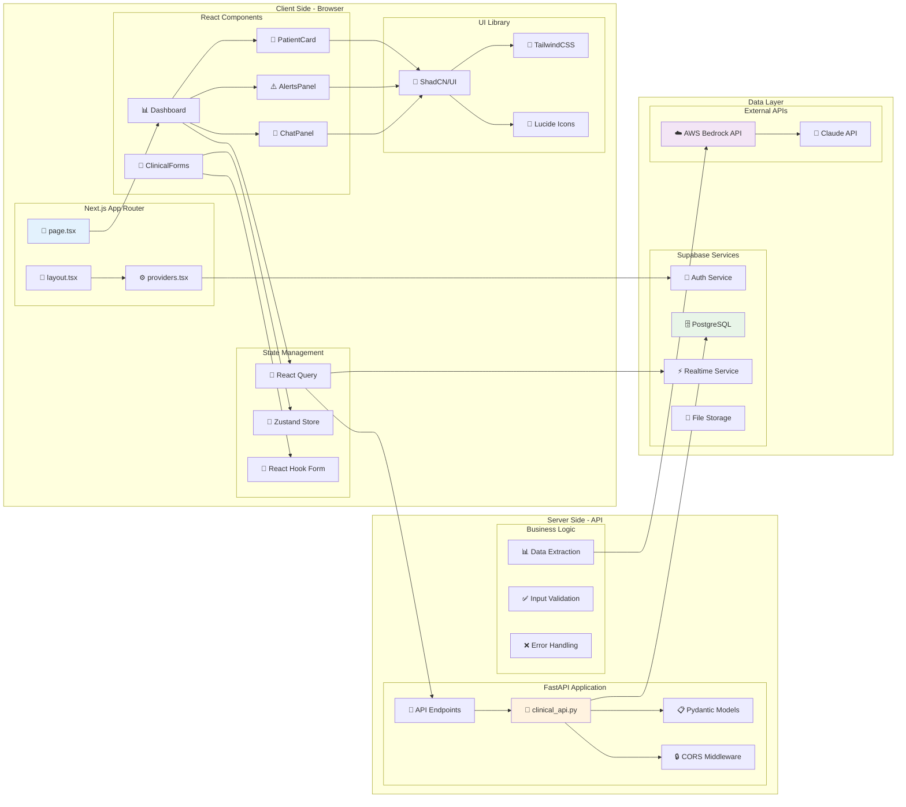
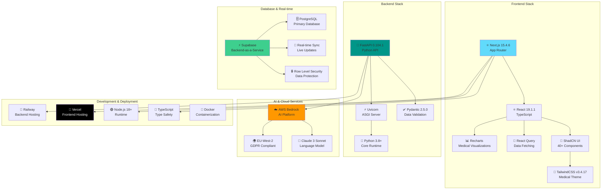
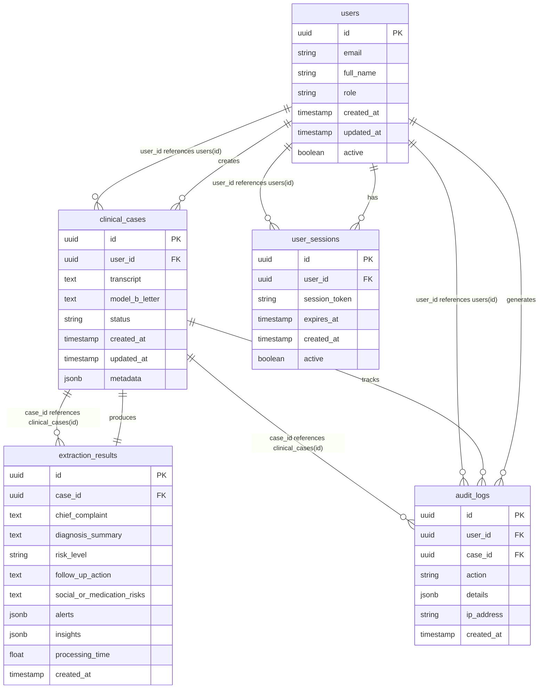
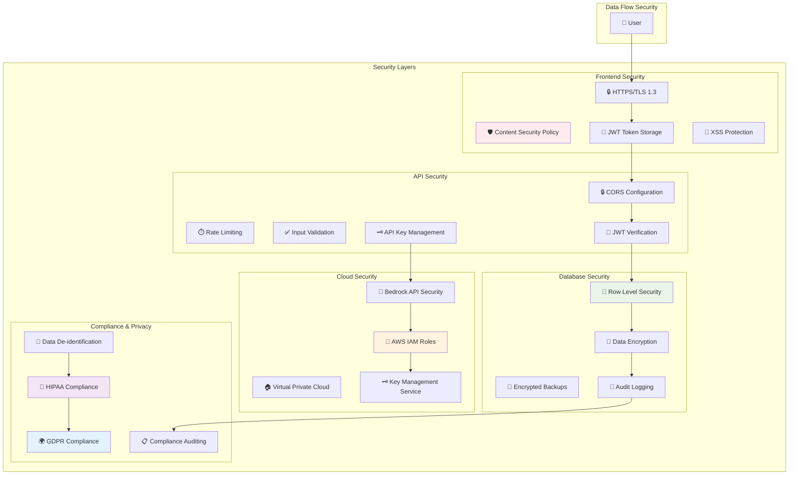
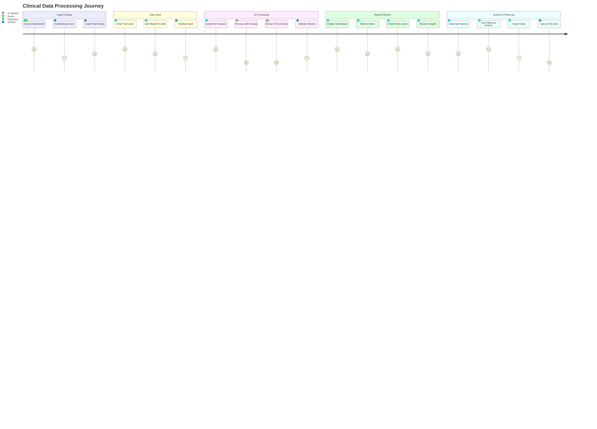
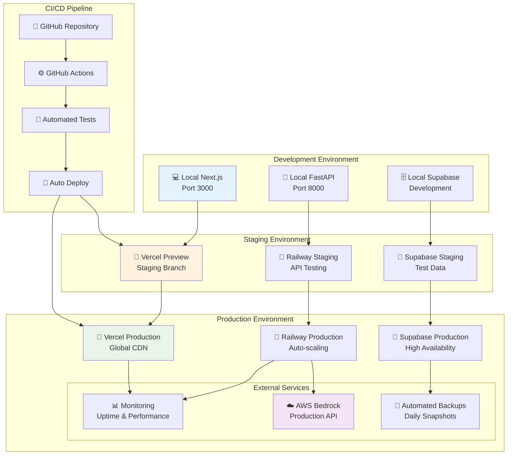

# ClinicalPad - System Architecture & Use Case Diagrams

## 📋 Use Case Diagram

## 🏗️ System Architecture Diagram

## 🔄 Data Flow Diagram

## 🏛️ Component Architecture Diagram

## 🔧 Technology Stack Diagram

## 📊 Database Schema Diagram

## 🔐 Security Architecture Diagram

## 📱 User Journey Flow Diagram

## 🔄 Deployment Architecture

---

## 📋 Diagram Summary

### Use Case Diagram
- **Actors**: Physicians, Nurses, Administrators, Patients
- **Core Functions**: Clinical data input, AI processing, dashboard views, alerts
- **Extended Features**: Batch processing, mobile entry, audit trails

### Architecture Diagram  
- **Frontend**: Next.js with ShadCN components and medical UI
- **Backend**: FastAPI with AWS Bedrock Claude integration
- **Database**: Supabase with real-time sync and security
- **AI Layer**: Claude 3 Sonnet for clinical data extraction

### Technology Stack
- **Modern Web**: Next.js 15.4.6 + React 19.1.1 + TypeScript
- **Backend**: FastAPI + Python with Pydantic validation
- **AI**: AWS Bedrock Claude 3 Sonnet (EU-West-2)
- **Database**: Supabase PostgreSQL with real-time features

### Security Architecture
- **Multi-layer Security**: Frontend, API, Database, and Cloud security
- **Compliance Ready**: HIPAA and GDPR compliance measures
- **Data Protection**: Encryption, de-identification, and audit trails

These diagrams provide a comprehensive visual representation of the ClinicalPad system architecture, showing how all components work together to create a secure, scalable medical data processing platform.